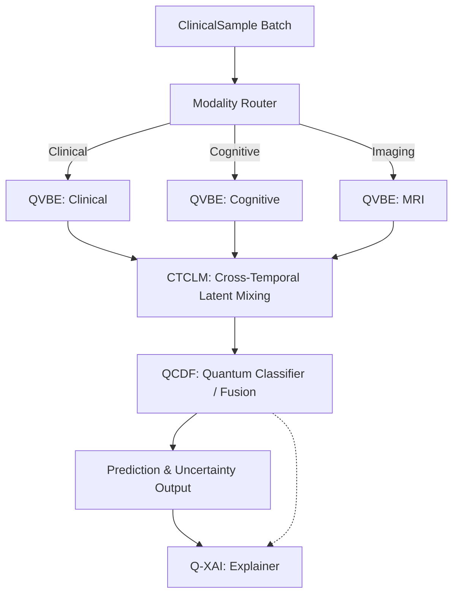

# Nāḍī-Q Architecture Readiness Review

**Date:** 2026-09-10
**Context:** One-time architecture review before implementing the core Multimodal Quantum Engine (QVBE, CTCLM, QCDF). 
**Goal:** Ensure the framework is stable, disease-agnostic, and prepared for future multi-dataset, multi-modal integration without requiring structural rewrites.

---

## 1. Current Architecture & Stable Interfaces

The current data and temporal foundations are well-abstracted:
- **Dataset Adapters (`BaseDatasetLoader`)**: Resolves data from arbitrary sources (like TADPOLE) into standardized sequences.
- **Universal Contract (`ClinicalSample`)**: The single source of truth for downstream modeling. Contains identifiers, labels, metadata, and a dictionary of modalities.
- **Modality Container (`FeatureBlock`)**: Encapsulates data (`values`), missingness (`missing_mask`), semantic names (`feature_names`), and type (`dtype`) per modality.
- **Temporal Sequences (`PatientTimeline`, `PredictionSnapshot`)**: Separates longitudinal timeline construction from specific snapshot logic, enforcing strict left-truncation (leakage firewalls).
- **Labels (`TemporalLabel`)**: A flexible schema for outcomes supporting binary, regression, and time-to-event targets alongside censoring flags.
- **Evaluation**: Decoupled from data loading, using standard NumPy arrays extracted from the unified `ClinicalSample` representation.

## 2. Universal Model Input Contract

To support long-term intelligence engine scaling without core modification, **the engine will exclusively consume batches of `ClinicalSample` objects**. 

This completely abstracts away dataset-specific schemas. The engine expects:
- **Patient ID**: `sample.sample_id` (anonymized)
- **Modalities**: `sample.features` (Dictionary mapping `ModalityType` string keys to `FeatureBlock`s).
- **Timestamps / Longitudinal Sequences**: If a modality represents a time-series, the `FeatureBlock` will contain the sequence array, along with an explicit `time_offsets` array (measuring intervals).
- **Missing Modalities**: Represented purely by the absence of a specific key in the `sample.features` dictionary, or flagged via `missing_mask` inside the `FeatureBlock`.
- **Provenance**: `sample.metadata` tracking the dataset and subset origins.

## 3. Dataset Adapter Boundary

A new dataset can be added securely *without* modifying the core intelligence engine. 
The boundary is strict:
1. Implement a new class inheriting from `BaseDatasetLoader`.
2. Map raw fields to the `PatientTimeline` intermediate structure.
3. Use the centralized `snapshots.py` infrastructure to extract strictly isolated prediction snapshots.
4. Yield normalized `ClinicalSample` objects.

Since the engine relies only on `ClinicalSample`, the underlying dataset (ADNI, PPMI, MIMIC) remains completely opaque to the model.

## 4. Modality and Missing-Modality Strategy

Can a new modality be added without modifying QVBE/CTCLM/QCDF? **Yes.**
- The system supports variable dictionary sizes (`dict[str, FeatureBlock]`).
- The intelligence engine must be designed to iterate over the available keys in `ClinicalSample.features`, mapping each to a dynamically allocated or registered Quantum Variational Basis Encoder (QVBE) block. 
- Missing modalities are handled naturally: if a `ClinicalSample` lacks the `IMAGE` key, the corresponding QVBE outputs a default masked embedding or the CTCLM skips that channel for that patient.

## 5. Temporal Representation Strategy

The architecture supports multiple paradigms:
- **Static Snapshots**: `FeatureBlock.values` is a 1D vector `(n_features,)`.
- **Longitudinal Sequences**: `FeatureBlock.values` is a 2D matrix `(n_timesteps, n_features)`.
- **Irregular Visit Intervals**: Supported.

*(Minimal architectural change applied: `time_offsets: Optional[np.ndarray] = None` was added to `FeatureBlock` in `contracts.py` to natively track irregular time deltas without changing the structural schema of the model interface).*

## 6. QVBE/CTCLM/QCDF Integration Points

The core engine will connect downstream of the DataLoader, specifically accepting a `ClinicalSample` batch. The forward pass flows as follows:

## 7. Required Minimal Changes

The architecture was already 99% ready. Only one fundamental change was necessary and has been executed:
- **`FeatureBlock` enhancement**: Added a `time_offsets` array field to track relative timestamps/intervals natively within the modality tensor structure. This enables sequence modeling inside QVBE without adding convoluted metadata parsers.

## 8. Frozen Interfaces
The following core interfaces **must remain frozen** before implementing the QVBE/CTCLM/QCDF logic, to prevent breaking the temporal data pipelines and leakage firewalls:
1. `ClinicalSample`
2. `FeatureBlock` 
3. `BaseDatasetLoader`
4. `PatientTimeline` & `PredictionSnapshot`
5. `TemporalLeakageChecker`

## 9. Explicit "Do NOT Change" Mandates
- **Do NOT** change the `snapshots.py` temporal generation rules.
- **Do NOT** change the left-truncation and leakage firewalls.
- **Do NOT** inject domain-specific concepts (like dementia stages) into the generic Data Contracts.
- **Do NOT** hardcode model input shapes to a specific dataset's column count. The engine must read dimensions from `DatasetSchema.feature_dims`.
