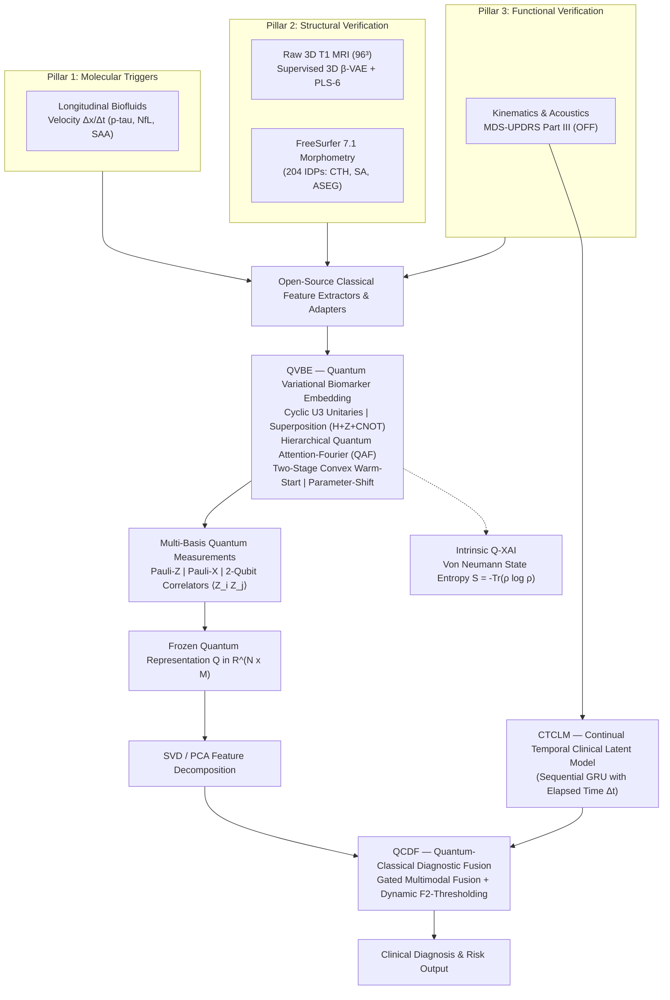

# NĀḌĪ-Q — PHASE 4: PROJECT ARCHITECTURE ALIGNMENT & REALIGNMENT REPORT
**Document ID**: `NADIQ-PHASE4-ALIGN-001`  
**Locations**:  
- `docs/phase4/PROJECT_ARCHITECTURE_ALIGNMENT.md`  
- `F:\NADI-Q_AUDIT_OUTPUT\PHASE_4\PROJECT_ARCHITECTURE_ALIGNMENT.md`  
**Date**: 2026-11-03  
**Auditor**: Lead Quantum Machine Learning Researcher & Senior AI/ML Systems Engineer  
**Status**: APPROVED & ACTIVE  

---

## 1. PURPOSE & SCIENTIFIC IMPERATIVE

Phase 3 established a rigorous negative baseline: a naive projected quantum kernel (PQK) using standard continuous rotation maps on tabular features underperforms classical gradient-boosted trees and classical RBF kernels ($\text{AUROC } 0.7817 \text{ vs } 0.8664$, $p < 0.001$), suffering from severe kernel concentration (effective rank $\approx 1.31$, off-diagonal elements $\approx 0.957$).

However, NĀḌĪ-Q's foundational research concept—as formulated in the original Smart India Hackathon (SIH 2026) submission for problem statement **SIH26139**—never proposed treating a quantum circuit merely as a black-box kernel classifier.

The original vision establishes the **Quantum Variational Biomarker Embedding (QVBE)** as a **feature-extraction and representation-learning engine** that transforms classical multimodal representations into expressive, non-linear quantum observable states to empower downstream clinical decision systems.

This document realigns the active codebase with the authoritative SIH submission documents, audits existing implementations, identifies architectural gaps, and establishes the formal Phase 4 engineering blueprint.

---

## 2. AUTHORITATIVE SIH 2026 ARCHITECTURAL SPECIFICATION

Inspection of the primary submission document (`C:\Users\ayush\OneDrive\Desktop\NADI-Q_Abstract_SRS_.docx`) and presentation materials establishes the definitive 7-layer NĀḌĪ-Q architecture:

---

## 3. AUDIT OF CURRENT IMPLEMENTATIONS VS ORIGINAL SRS

| Architectural Layer | SIH 2026 SRS Specification | Current Implementation in `src/nadiq/` | Status / Gap Analysis | Phase 4 Action |
| :--- | :--- | :--- | :--- | :--- |
| **Input Pillars** | 3-Pillar MFA: Molecular ($\Delta x/\Delta t$), Structural (3D $\beta$-VAE), Functional (Kinematics). | Disconnected scripts; FreeSurfer 204 IDPs validated in Phase 2/3; physical MRI prototype cohort ($N=36$) frozen. | **Pillar Mismatch**: Phase 3 evaluated FreeSurfer tabular inputs directly without classical pretrained adapters. | Create explicit modality adapters separating raw 3D MRI from tabular FreeSurfer morphometry and longitudinal biomarkers. |
| **QVBE Ansatz** | Cyclic $U_3(\theta, \phi, \lambda)$ unitaries, Hadamard superposition, cyclic CNOT ladders. | `qvbe.py` implements $R_y(\text{in}) \to [R_y, R_z, R_y](\theta) \to \text{CNOT}$ ring. | **Partial Implementation**: Uses separate Pauli rotations instead of full arbitrary $U_3$ unitaries. | Implement full cyclic $U_3(\theta, \phi, \lambda)$ parameterized layers in `qvbe_v2.py`. |
| **Hierarchical QAF Layer** | Quantum Attention-Fourier (QAF) with controlled phase rotations to capture global frequency epistasis. | **COMPLETELY MISSING** in `qvbe.py`. | **Major Architecture Gap**: No controlled phase / Fourier entanglement layer existed. | Formulate and implement documented prototype QAF layer using hierarchical $CPHASE(\Delta\theta)$ gates. |
| **Quantum Measurements** | Dual-basis readout ($\langle Z \rangle, \langle X \rangle$) and state probing. | Only Pauli-$Z$ expectations implemented in `qvbe.py`. (Phase 3 tested $Z + X$ in temporary script). | **Incomplete Observables**: No 2-qubit correlators $\langle Z_i Z_j \rangle$ or projection protocol. | Implement formal measurement layer returning $Z$, $X$, and entangling correlators with finite-shot noise modeling. |
| **Optimization Strategy** | Two-Stage Convex Warm-Start followed by nonconvex refinement via parameter-shift rule. | Only standard PyTorch Adam optimizer over `TorchLayer`. | **Underspecified / Missing**: No convex warm-start initialization logic existed in code. | Implement classical convex kernel initialization (warm-start) prior to variational gradient tuning. |
| **Freeze / Export Protocol** | Standalone frozen feature extractor returning deterministic representation matrix. | QVBE was tightly coupled to a PyTorch `forward()` call returning an in-graph tensor. | **Missing Freeze Contract**: No `freeze()`, `save()`, `load()` interface existed for offline ML. | Implement full Scikit-Learn compatible `fit()`, `transform()`, `freeze()`, `save()`, `load()` engine. |
| **CTCLM** | GRU with relative time embedding $\Delta t$ and valid sequence masking. | `ctclm.py` fully implemented and verified (50 unit tests passing). | **Established [A]**: Fully operational for sequential data. | Preserve intact. Integrate as functional branch when longitudinal sequences are fed to QCDF. |
| **QCDF** | Gated fusion MLP with availability indicators and dynamic $F_2$ tuning. | `qcdf.py` implemented and verified (3 unit tests passing). | **Established [A]**: Operational for multimodal vector fusion. | Preserve intact. Define target input signatures to receive frozen QVBE features + CTCLM states. |
| **Q-XAI** | Von Neumann entropy $S = -\text{Tr}(\rho \log \rho)$ + LiteViT-CAM heatmaps. | Conceptual; partial stub in tests. | **Hypothesis [B]**: Mathematical formula clear, but no runtime density matrix extractor. | Implement explicit density matrix reconstruction for local subsystems to extract $S(\rho_k)$. |

---

## 4. REUSABLE ASSETS & INFRASTRUCTURE

The following assets developed across Phases 1–3 are fully validated and will be reused directly in Phase 4:

1. **Primary Benchmark Cohort Dataset**:
   - `F:\NADI-Q_AUDIT_OUTPUT\PHASE_3\DATA\ppmi_primary_benchmark_cohort_n1465.parquet`
   - Verified $N = 1,465$ baseline participants (837 Positive : 628 Negative) with 0.00% missingness across 204 FreeSurfer IDPs and 38 unmedicated MDS-UPDRS Part III items.
2. **Deterministic Split Manifest**:
   - `F:\NADI-Q_AUDIT_OUTPUT\PHASE_3\PARTICIPANT_SPLIT_MANIFEST.csv`
   - Exact 25-fold stratified cross-validation manifest (5 seeds $\times$ 5 folds, 293 test subjects/fold). Guarantees 100% fair comparability against Phase 3 baselines!
3. **Evaluation & Calibration Engine**:
   - `scripts/phase3/benchmark_engine.py` (AUROC, AUPRC, Balanced Accuracy, Brier score, ECE, DeLong tests, Bootstrap CIs).
4. **Passing Scientific Test Suite**:
   - 189 tests in `tests/scientific/` passing with 100% success.

---

## 5. EXPERIMENTAL ASSUMPTIONS & SCIENTIFIC CONSTRAINTS

1. **Representation Learning, Not Direct Classification**:
   - The quantum circuit will not output a single binary logit or act as a kernel SVM.
   - It will function as a **variational representation engine** mapping classical embeddings $\mathbf{z} \in \mathbb{R}^d$ into quantum measurement vectors $\mathbf{q} \in \mathbb{R}^M$.
2. **Strict Offline Freezing**:
   - Once trained on the training partition ($X_{\text{train}}$), the quantum extractor's parameters $\theta^*$ are frozen.
   - Downstream models (LightGBM, XGBoost, Logistic Regression) train strictly on the resulting feature matrices.
3. **No Claim of Unconditional Advantage**:
   - If quantum observable features do not provide an empirical boost over classical embeddings (measured via paired bootstrap difference and DeLong tests), this will be reported faithfully as a verified scientific limitation of NISQ representations on tabular clinical data.

