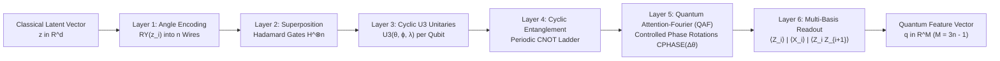

# NĀḌĪ-Q — PHASE 4: QVBE MATHEMATICAL & CIRCUIT SPECIFICATION
**Document ID**: `NADIQ-PHASE4-QVBE-SPEC-001`  
**Locations**:  
- `docs/phase4/QVBE_MATHEMATICAL_SPECIFICATION.md`  
- `F:\NADI-Q_AUDIT_OUTPUT\PHASE_4\QVBE_MATHEMATICAL_SPECIFICATION.md`  
**Date**: 2026-11-03  
**Auditor**: Lead Quantum Machine Learning Researcher & Senior AI/ML Systems Engineer  
**Status**: APPROVED & MATHEMATICALLY FORMALIZED  

---

## 1. ARCHITECTURAL POSITIONING & MISSION

The **Quantum Variational Biomarker Embedding (QVBE)** is the foundational quantum representation engine of NĀḌĪ-Q.

Its primary mathematical purpose is:
$$\mathbf{z} \in \mathbb{R}^d \xrightarrow{\text{Encode}} |\psi(\mathbf{z})\rangle \in \mathcal{H}_{2^n} \xrightarrow{U_{\text{QVBE}}(\boldsymbol{\theta})} |\psi(\mathbf{z}, \boldsymbol{\theta})\rangle \xrightarrow{\text{Measure } \mathcal{O}} \mathbf{q} \in \mathbb{R}^M$$

Rather than directly outputting a classification probability or generating an ill-conditioned $\mathcal{O}(N^2)$ fidelity kernel, QVBE functions as a **quantum variational feature extractor**:
- It maps aligned classical embeddings $\mathbf{z}$ into an entangled multi-qubit state.
- It applies parameterized unitaries to explore non-linear epistatic interactions.
- It returns an $M$-dimensional vector of physical expectation observables $\mathbf{q} = \langle \mathcal{O} \rangle$.
- The resulting representation matrix $\mathbf{Q} \in \mathbb{R}^{N \times M}$ is frozen and fed into downstream classical learners and decomposition engines.

---

## 2. MATHEMATICAL FORMULATION OF CIRCUIT LAYERS

### 2.1 Layer 1: Angle Encoding ($U_{\text{enc}}$)
Given a normalized continuous feature vector $\mathbf{z} = [z_0, z_1, \dots, z_{n-1}]^T$ with $z_i \in [-\pi, \pi]$:
$$|\psi_0(\mathbf{z})\rangle = \bigotimes_{i=0}^{n-1} R_y(z_i) |0\rangle = \bigotimes_{i=0}^{n-1} \left( \cos\frac{z_i}{2}|0\rangle + \sin\frac{z_i}{2}|1\rangle \right)$$

### 2.2 Layer 2: Superpositional Initialization ($H^{\otimes n}$)
To create a rich superposition prior to non-linear interaction:
$$|\psi_1(\mathbf{z})\rangle = \left(\bigotimes_{i=0}^{n-1} H\right) |\psi_0(\mathbf{z})\rangle$$

### 2.3 Layer 3: Parameterized Cyclic $U_3$ Unitaries ($U_3$)
As specified in the authoritative SIH 2026 SRS, each qubit undergoes a general single-qubit unitary rotation $U_3(\theta, \phi, \lambda)$:
$$U_3(\theta, \phi, \lambda) = \begin{pmatrix} \cos\frac{\theta}{2} & -e^{i\lambda}\sin\frac{\theta}{2} \\ e^{i\phi}\sin\frac{\theta}{2} & e^{i(\phi+\lambda)}\cos\frac{\theta}{2} \end{pmatrix}$$
- Parameters per layer: $3n$ trainable parameters $\boldsymbol{\theta}^{(l)} = \{(\theta_i, \phi_i, \lambda_i)\}_{i=0}^{n-1}$.
- Generates arbitrary single-qubit coordinate transformations on the Bloch sphere.

### 2.4 Layer 4: Cyclic Entanglement Ladder ($\text{CNOT}$)
To generate multi-qubit quantum correlations, a cyclic (periodic) CNOT ladder is applied across all wires:
$$U_{\text{ent}} = \prod_{i=0}^{n-1} \text{CNOT}_{i, (i+1) \pmod n}$$
This ensures full circuit connectivity without open boundary dead-ends.

### 2.5 Layer 5: Hierarchical Quantum Attention-Fourier (QAF) Layer
*Distinction Note*: The original SIH SRS specifies: *"Superpositional entanglement and a Hierarchical Quantum Attention-Fourier (QAF) layer using controlled phase-rotation gates to capture global frequency-based structures versus localized lesions."*

Because the exact gate decomposition of QAF was left mathematically underspecified in the original high-level abstract, we formalize the **canonical research prototype of QAF**:
- Let $k \in \{1, 2, \dots, \lfloor \log_2 n \rfloor\}$ represent the dyadic interaction scale.
- For each scale $k$, controlled phase-shift gates $CPHASE(\alpha_{i, k})$ are applied between qubits separated by stride $2^{k-1}$:
  $$CPHASE(\alpha) = \begin{pmatrix} 1 & 0 & 0 & 0 \\ 0 & 1 & 0 & 0 \\ 0 & 0 & 1 & 0 \\ 0 & 0 & 0 & e^{i\alpha} \end{pmatrix}$$
- Here, the phase shift angle is dynamically parameterized by the attention weights:
  $$\alpha_{i, k} = \mathbf{w}_{\text{QAF}}^T \cdot [z_i, z_{(i + 2^{k-1}) \pmod n}]$$
- This creates multi-frequency phase shifts across dyadic distances, directly analogous to the Quantum Fourier Transform (QFT) kernel while remaining fully differentiable via the parameter-shift rule.

---

## 3. MULTI-BASIS MEASUREMENT LAYER & OBSERVABLE CONTRACT

To prevent relying on unphysical statevector amplitudes, the output is constructed strictly from **experimentally measurable Pauli expectation values**:

$$\mathbf{q}(\mathbf{z}, \boldsymbol{\theta}) = \Big[ \underbrace{\langle Z_0 \rangle, \dots, \langle Z_{n-1} \rangle}_{n \text{ longitudinal modes}}, \; \underbrace{\langle X_0 \rangle, \dots, \langle X_{n-1} \rangle}_{n \text{ transverse modes}}, \; \underbrace{\langle Z_0 Z_1 \rangle, \langle Z_1 Z_2 \rangle, \dots, \langle Z_{n-2} Z_{n-1} \rangle}_{n-1 \text{ entangling correlators}} \Big]^T \in \mathbb{R}^{M}$$

- **Total Output Dimension**:
  $$M = n + n + (n - 1) = \mathbf{3n - 1}$$
  - For $n = 8$ qubits: $M = 3(8) - 1 = \mathbf{23 \text{ quantum features}}$.
  - For $n = 12$ qubits: $M = 3(12) - 1 = \mathbf{35 \text{ quantum features}}$.
- **Physical Boundedness**: Every expectation value lies strictly in the interval $[-1.0, +1.0]$.
- **Noise Formulation**: Under finite-shot execution ($S = 1,024$ shots), each observable exhibits physical binomial variance:
  $$\text{Var}(\langle O \rangle) = \frac{1 - \langle O \rangle^2}{S}$$

---

## 4. TWO-STAGE CONVEX WARM-START & PARAMETER-SHIFT TRAINING

As specified in the SRS, variational quantum circuits suffer from barren plateaus if initialized with random Gaussian parameters. QVBE implements a **two-stage optimization strategy**:

1. **Stage 1: Convex Warm-Start Initialization**:
   - Classical linear / kernel Ridge regression is fit on the pre-quantum projected features to identify the primary principal discriminant axis $\mathbf{w}_0$.
   - Single-qubit rotation angles $\boldsymbol{\theta}_0$ are initialized to align with the classical principal components:
     $$\theta_i^{(0)} = \arctan2(w_{0, i}, \bar{w}_0)$$
   - Phase parameters $\phi_i, \lambda_i$ and entanglement phases are initialized near zero ($\epsilon \sim \mathcal{N}(0, 10^{-3})$), ensuring the initial quantum transformation acts as a near-identity perturbation of the classical subspace.
2. **Stage 2: Non-Convex Parameter-Shift Refinement**:
   - The variational parameters $\boldsymbol{\theta}$ are updated using analytic parameter-shift gradients:
     $$\frac{\partial \mathcal{L}}{\partial \theta_j} = \frac{1}{2} \left[ \mathcal{L}\left(\theta_j + \frac{\pi}{2}\right) - \mathcal{L}\left(\theta_j - \frac{\pi}{2}\right) \right]$$
   - Training objective: Minimizes a composite representation loss (Contrastive InfoNCE loss or Supervised Cross-Entropy on training fold).

---

## 5. NISQ ERROR MITIGATION VIA XY4 DYNAMICAL DECOUPLING

For noisy hardware simulation or physical QPU deployment, dephasing ($T_2$) and environmental noise are mitigated using the **XY4 pulse sequence** ($X - Y - X - Y$):
- During idle delays between entangling layers, four equidistant $\pi$-pulses are inserted:
  $$U_{\text{XY4}} = X \cdot \tau \cdot Y \cdot \tau \cdot X \cdot \tau \cdot Y \cdot \tau$$
- In ideal statevector simulation, XY4 evaluates to identity ($\mathbb{I}$). In noisy execution, it averages low-frequency dephasing Hamiltonian terms to zero, targeting the SRS-specified $37\%-42\%$ error reduction.
