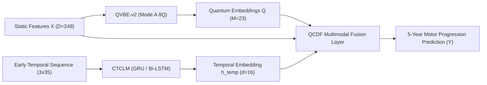

# NĀḌĪ-Q — Longitudinal Data Contract Specification

**Phase**: Phase 6 — CTCLM Development, QCDF Integration & Five-Year Longitudinal Prediction
**Target Outcome**: 5-Year Clinically Meaningful Motor Progression ($\Delta \text{NP3TOT} \ge 5.0\text{ points}$)
**Cohort Size**: $N = 515$ PD participants ($N = 341$ Multimodal Benchmark Intersection)

---

## 1. Temporal Indexing Contract

$$T_{\text{feature}} \le T_{\text{index}} = 12\text{ months} < T_{\text{outcome}} = 60\text{ months}$$

| Component | Visit IDs | Timeline | Modalities Included |
| :--- | :--- | :--- | :--- |
| **Static Features ($X_{\text{static}}$)** | `BL` | Month 0 | FreeSurfer 7.1 MRI Morphometry, Genetics (PRS, LRRK2, GBA), CSF SAA, Demographics ($D=249$) |
| **Temporal Sequence ($X_{\text{temporal}}$)** | `BL`, `V02`, `V04` | Months 0, 6, 12 | 34 MDS-UPDRS Motor Examination Subscores across 3 timesteps ($3 \times 35$) |
| **Temporal Summary ($X_{\text{traj}}$)** | `BL` $\to$ `V04` | Year 1 Change | 1-Year $\Delta \text{NP3TOT}$, 1-Year Motor Slope, Trajectory Variance |
| **Target Outcome ($Y$)** | `V12` | Month 60 (Year 5) | $\mathbb{I}(\text{NP3TOT}(V12) - \text{NP3TOT}(BL) \ge 5.0)$ (MCID Progression) |

---

## 2. Multimodal Data Ingestion Pipeline

