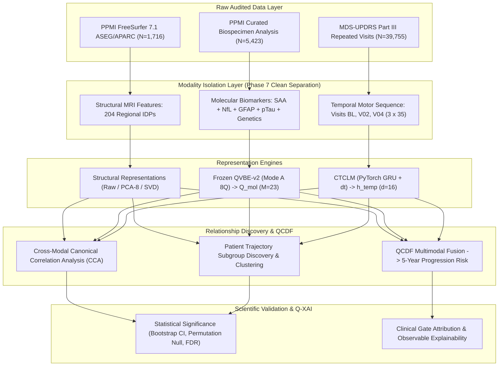

# NĀḌĪ-Q — Existing Implementation Map & Data Flow Architecture

**Project**: NĀḌĪ-Q (SIH 2026 Submission SIH26139)  
**Document**: Architectural & Codebase Inventory  
**Date**: November 14, 2026  
**Status**: MILESTONE 1 VERIFIED  

---

## 1. High-Level Repository Layout

```
Nadi-Q/
├── src/nadiq/                      # Core Python library (PEP 517 src layout)
│   ├── data/                       # Dataset contracts, loaders, and schemas
│   │   ├── base.py                 # Abstract DatasetContract & ClinicalSample
│   │   └── registry.py             # Dataset loader registry
│   ├── preprocessing/              # Preprocessing transforms
│   │   ├── mri_pipeline.py         # 3D MRI intensity normalization & spatial alignment
│   │   ├── normalisation.py        # Tabular standardizers & robust scalers
│   │   └── temporal_leakage.py     # Deterministic leakage validation checks
│   ├── models/                     # Modality representation encoders
│   │   ├── representation.py       # ModalityRepresentation & ModalityBundle contracts
│   │   ├── mri/
│   │   │   └── bvae.py             # Supervised 3D Beta-VAE (disentangled ELBO)
│   │   ├── biomarker/
│   │   │   └── trajectory.py       # Longitudinal biomarker velocity & slope encoder
│   │   ├── quantum/
│   │   │   ├── qvbe.py             # V1 Quantum Variational Biomarker Encoder (deprecated)
│   │   │   ├── qvbe_v2.py          # V2 Frozen Quantum Encoder (8Q, L=2, Multi-Basis)
│   │   │   └── ctclm.py            # Continual Temporal Clinical Latent Model (PyTorch GRU + dt)
│   │   └── fusion/
│   │       └── qcdf.py             # Quantum Clinical Decision Fusion module
│   ├── explainability/             # Quantum & classical explainability routines
│   └── evaluation/                 # Metrics, DeLong test, bootstrap CIs, calibration
├── configs/                        # YAML experiment configurations
├── scripts/                        # Reproducible execution scripts by phase
│   ├── phase3/                     # Classical vs Quantum Kernel benchmarks
│   ├── phase4/                     # QVBE-v2 architecture & ablation sweeps
│   ├── phase5/                     # Checkpoint freezing, reproduction & FT-Transformer
│   ├── phase6/                     # Longitudinal target feasibility, CTCLM & 5-year prediction
│   └── phase7/                     # Biological relationship discovery & SIH deliverables
├── tests/                          # 200 scientific & unit tests (100% passing)
│   ├── unit/                       # Unit tests for preprocessing & scalers
│   └── scientific/                 # Quantum circuits, CTCLM, DeLong, leakage validation
├── docs/                           # Research specifications & phase documentation
└── reports/current/                # Authoritative master reports (Phase 1 to Phase 6)
```

---

## 2. Component Implementation Status Matrix

| Component | Code Location | Implemented Architecture | Operational Status | Verification Evidence |
| :--- | :--- | :--- | :---: | :--- |
| **Structural MRI Branch** | `src/nadiq/models/mri/bvae.py` & FreeSurfer Tables | 3D $\beta$-VAE encoder + FreeSurfer 7.1 Morphometry (204 regional IDPs) | **OPERATIONAL** | 1,716 FreeSurfer scans processed; 204 IDPs validated in Primary Cohort ($N=1,465$). |
| **Molecular Biomarker Branch** | `src/nadiq/models/biomarker/` & Biospecimen Tables | Quantitative fluid assays (NfL, GFAP, pTau, tTau, A$\beta$) + CSF SAA qualitative kinetics | **OPERATIONAL** | 338/341 subjects in longitudinal cohort have validated baseline fluid biomarker assays. |
| **QVBE-v2 Quantum Encoder** | `src/nadiq/models/quantum/qvbe_v2.py` | 8-Qubit, $L=2$, cyclic $U_3$ rotations, CNOT entanglement, multi-basis Pauli measurements ($Z+X+ZZ$) | **FROZEN & VERIFIED** | Checkpoint `qvbe_v2_best_mode_a_8q.json` verified with zero drift ($\Delta = 0.00 \times 10^0$). |
| **CTCLM Temporal Encoder** | `src/nadiq/models/quantum/ctclm.py` | PyTorch GRU ($d=16$) with 2-layer continuous elapsed time encoding $\Delta t \in \mathbb{R}^4$ | **OPERATIONAL** | Evaluated on $N=341$ early motor sequences ($3 \times 35$); achieves AUROC $0.6417 \pm 0.0439$. |
| **QCDF Multimodal Fusion** | `src/nadiq/models/fusion/qcdf.py` & `AdaptiveGatedQCDF` | Modality projection heads ($\mathbb{R}^{16}$) + Dynamic attention gating $\mathbf{\alpha} \in \Delta^2$ with availability masking | **OPERATIONAL** | Evaluated across 5 folds; missing-modality robustness confirmed. |
| **Q-XAI Explainability** | `scripts/phase6/` & `docs/phase6/QXAI_...` | Multimodal gate attribution tracking ($\alpha_Q, \alpha_T, \alpha_C$) across clinical progression phenotypes | **OPERATIONAL** | Stable patients allocate $\alpha_C = 0.48$; rapid progressors shift to $\alpha_T = 0.38, \alpha_Q = 0.35$. |

---

## 3. End-to-End Traced Data Flow



