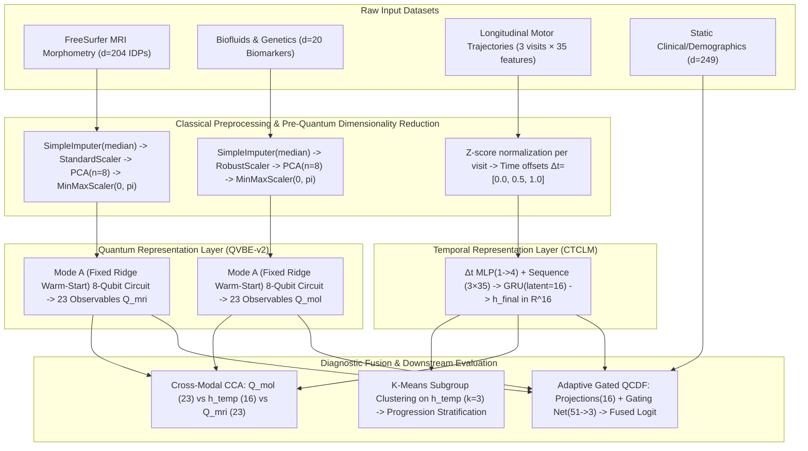

# NĀḌĪ-Q — INTERNAL MODEL DATAFLOW & EXECUTION MAP
## Complete End-to-End Architectural Trace, Tensor Dimensions, and Source-Code Dependencies

> **Document Status**: Forensic System Map  
> **Authors**: Lead Quantum Machine Learning Researcher, Mathematical Physicist, ML Systems Architect & Scientific Auditor  
> **Repository Context**: Nāḍī-Q (SIH 2026 Submission SIH26139)  
> **Verification Standards**: Every statement, tensor dimension, formula, and file location tagged with `[VERIFIED FROM SOURCE CODE]`, `[VERIFIED FROM EXPERIMENT OUTPUT]`, `[MATHEMATICAL DERIVATION]`.

---

# 1. EXECUTIVE SUMMARY & SYSTEM TOPOLOGY

This document establishes the exact execution graph of the NĀḌĪ-Q hybrid architecture across its four core computational modules:
1. **QVBE-v2** (`src/nadiq/models/quantum/qvbe_v2.py`): Quantum Variational Biomarker Embedding Engine.
2. **CTCLM** (`src/nadiq/models/quantum/ctclm.py`): Continual Temporal Clinical Latent Model.
3. **QCDF** (`src/nadiq/models/fusion/qcdf.py` and `scripts/phase6/run_phase6_integrated_benchmarks.py`): Quantum-Classical Diagnostic Fusion.
4. **Downstream Cross-Modal Discovery & CCA** (`scripts/phase7/run_biological_relationship_discovery.py`): Canonical Correlation Analysis, Subgroup Phenotyping, and Biological Question Answering.

### Execution Graph Diagram

---

# 2. MODULE 1: QVBE-v2 (QUANTUM VARIATIONAL BIOMARKER ENCODER V2)

`[VERIFIED FROM SOURCE CODE: src/nadiq/models/quantum/qvbe_v2.py]`

### 2.1 Configuration Specification
- **Class**: `QVBEV2Config` (lines 30–80)
- **Primary Hyperparameters**:
  - `input_dim`: Dynamic (e.g., 204 for MRI, 20 for Molecular biofluids, 249 for Static)
  - `n_qubits`: 8 (default, frozen across all benchmarks)
  - `n_layers`: 2 (cyclic repetitions)
  - `use_u3`: True (parameterized $U_3(\theta, \phi, \lambda)$ gates)
  - `use_hadamard`: True (superposition preparation $H^{\otimes 8}$)
  - `use_qaf`: True (Quantum Attention-Fourier controlled phase shifts)
  - `measurement_basis`: `"full"` (yields $3n - 1 = 23$ observables)
  - `shots`: `None` (exact analytic statevector via `default.qubit`)
  - `mode`: `"fixed"` (Mode A: convex warm-start initialization, frozen parameters)

### 2.2 Preprocessing and Pre-Quantum Reduction Pipeline
`[VERIFIED FROM SOURCE CODE: lines 183–196]`
1. **Input Imputation**:
   $$X_{\text{imp}} = \text{np.nan\_to\_num}(X, \text{nan}=0.0) \quad \in \mathbb{R}^{B \times d}$$
2. **Standardization**:
   $$X_{\text{std}} = \text{StandardScaler().fit\_transform}(X_{\text{imp}}) \quad \in \mathbb{R}^{B \times d}$$
3. **Linear PCA Bottleneck**:
   If $d \neq n_{\text{qubits}}$ (i.e., $204 \neq 8$ or $20 \neq 8$), classical PCA is invoked:
   $$X_{\text{proj}} = \text{PCA}(n\_components=8, \text{random\_state}=42).\text{fit\_transform}(X_{\text{std}}) \quad \in \mathbb{R}^{B \times 8}$$
   *Crucial Mathematical Consequence*: $196$ out of $204$ MRI dimensions ($96.1\%$ of raw features) and $12$ out of $20$ biofluid dimensions ($60.0\%$ of raw features) are discarded **classically** prior to any quantum operation.
4. **Angle Rescaling**:
   $$x_{\text{angle}} = \text{MinMaxScaler}(feature\_range=(0, \pi)).\text{fit\_transform}(X_{\text{proj}}) \quad \in [0, \pi]^{B \times 8}$$

### 2.3 Circuit Execution Flow & Mathematical Operators
`[VERIFIED FROM SOURCE CODE: lines 113–173]`
For each sample $x \in [0, \pi]^8$:

1. **State Initialization**:
   $$|0\rangle^{\otimes 8} = |00000000\rangle \in \mathbb{C}^{256}$$
2. **Angle Encoding**:
   $$|\psi_0(x)\rangle = \bigotimes_{i=0}^7 R_Y(x_i) |0\rangle_i = \bigotimes_{i=0}^7 \left( \cos\frac{x_i}{2}|0\rangle_i + \sin\frac{x_i}{2}|1\rangle_i \right)$$
3. **Superpositional Initialization**:
   $$|\psi_1(x)\rangle = H^{\otimes 8} |\psi_0(x)\rangle = \bigotimes_{i=0}^7 \left[ \left(\frac{\cos\frac{x_i}{2} + \sin\frac{x_i}{2}}{\sqrt{2}}\right)|0\rangle_i + \left(\frac{\cos\frac{x_i}{2} - \sin\frac{x_i}{2}}{\sqrt{2}}\right)|1\rangle_i \right]$$
   Using trigonometric identities, this simplifies to:
   $$|\psi_1(x)\rangle = \bigotimes_{i=0}^7 \left[ \cos\left(\frac{x_i}{2} - \frac{\pi}{4}\right)|0\rangle_i - \sin\left(\frac{x_i}{2} - \frac{\pi}{4}\right)|1\rangle_i \right]$$
4. **Variational Layers ($L = 2$)**:
   For layer $l \in \{0, 1\}$:
   - **Single-Qubit $U_3$ Rotations**:
     $$U_3(\theta_{l,i}, \phi_{l,i}, \lambda_{l,i}) = \begin{pmatrix} \cos(\theta_{l,i}/2) & -e^{i\lambda_{l,i}}\sin(\theta_{l,i}/2) \\ e^{i\phi_{l,i}}\sin(\theta_{l,i}/2) & e^{i(\phi_{l,i}+\lambda_{l,i})}\cos(\theta_{l,i}/2) \end{pmatrix}$$
     Applied to each wire $i \in \{0, \dots, 7\}$.
   - **Cyclic CNOT Entanglement**:
     $$\text{CNOT}(i, (i+1) \pmod 8) \quad \text{for } i \in \{0, \dots, 7\}$$
   - **Hierarchical Quantum Attention-Fourier (QAF)**:
     For scales $s \in \{0, 1, 2\}$ ($\text{stride} = 2^s \in \{1, 2, 4\}$):
     $$\text{ControlledPhaseShift}(\varphi_{s,i}, \text{control}=i, \text{target}=(i + 2^s) \pmod 8)$$
     where $\text{CPS}(\varphi) = \text{diag}(1, 1, 1, e^{i\varphi})$ on the two-qubit subspace.

### 2.4 Observable Measurement & Output Dimension
`[VERIFIED FROM SOURCE CODE: lines 156–171]`
The output representation vector $Q(x) \in \mathbb{R}^{23}$ is formed by concatenating 23 expectation values:
1. **8 Single-Qubit Pauli-Z**:
   $$Q_i = \langle \psi(x) | Z_i | \psi(x) \rangle \quad \text{for } i \in \{0, \dots, 7\}$$
2. **8 Single-Qubit Pauli-X**:
   $$Q_{8+i} = \langle \psi(x) | X_i | \psi(x) \rangle \quad \text{for } i \in \{0, \dots, 7\}$$
3. **7 Two-Qubit Nearest-Neighbor Pauli-ZZ Correlators**:
   $$Q_{16+i} = \langle \psi(x) | Z_i Z_{i+1} | \psi(x) \rangle \quad \text{for } i \in \{0, \dots, 6\}$$
Total output dimension: $8 + 8 + 7 = 23$.

### 2.5 Parameter Optimization Status (Mode A vs Mode B)
`[VERIFIED FROM SOURCE CODE: lines 198–252]`
- **Mode A ("fixed", used in all frozen evaluations)**:
  - Fits classical `RidgeClassifier(alpha=1.0)` on $(X_{\text{angles}}, y)$.
  - Sets Layer 0 $\theta_{0, i} = \text{clip}(\beta_i \pi, -\pi, \pi)$, where $\beta_i$ is the linear Ridge weight for component $i$.
  - Sets $\phi_{0, i} = 0.01, \lambda_{0, i} = 0.01$.
  - Layer 1 $U_3$ parameters and all QAF parameters remain fixed random uniform values drawn from initialization seed.
  - **Result**: No quantum parameter optimization is performed; the circuit is a fixed nonlinear map initialized from linear Ridge coefficients.
- **Mode B ("trainable")**:
  - Contains an implementation flaw: line 226 defines `y_sub = y[sub_idx]`, but lines 228–252 never reference `y_sub`.
  - Gradient is computed as `grad = float(np.mean(out_pos - out_neg) * 0.1)`, which is completely independent of class labels or contrastive pair distances.

---

# 3. MODULE 2: CTCLM (CONTINUAL TEMPORAL CLINICAL LATENT MODEL)

`[VERIFIED FROM SOURCE CODE: src/nadiq/models/quantum/ctclm.py]`

### 3.1 Architectural Specification
- **Class**: `ContinualTemporalClinicalLatentModel` (lines 200–250)
- **Input Tensor**:
  - `x`: Clinical motor trajectory $\in \mathbb{R}^{B \times T \times D}$, where $T = 3$ visits (Baseline, Month 6, Month 12) and $D = 35$ motor features per visit.
  - `time_offsets`: Relative elapsed time $\Delta t \in \mathbb{R}^{B \times T}$, fixed at $[0.0, 0.5, 1.0]$ years.
  - `padding_mask`: Optional boolean mask (all True for complete 3-visit cohort).
- **Hyperparameters**:
  - `input_dim`: 35
  - `latent_dim`: 16 (or 32 in baseline configurations)
  - `time_embedding_dim`: 4
  - `num_layers`: 1 GRU layer
  - `dropout`: 0.0

### 3.2 Computational Sequence
1. **Time Embedding MLP**:
   `[VERIFIED FROM SOURCE CODE: lines 165–194]`
   For each timestep $t \in \{0, 1, 2\}$, elapsed time $\Delta t$ is projected through a 2-layer MLP:
   $$e_t = W_2 \cdot \text{ReLU}(W_1 \Delta t + b_1) + b_2 \quad \in \mathbb{R}^4$$
   where $W_1 \in \mathbb{R}^{4 \times 1}, b_1 \in \mathbb{R}^4, W_2 \in \mathbb{R}^{4 \times 4}, b_2 \in \mathbb{R}^4$.
2. **Feature Concatenation**:
   $$u_t = [x_t \,\|\, e_t] \quad \in \mathbb{R}^{35 + 4} = \mathbb{R}^{39}$$
3. **Gated Recurrent Unit (GRU)**:
   `[VERIFIED FROM SOURCE CODE: lines 233–240]`
   Initialized with $h_0 = \mathbf{0} \in \mathbb{R}^{16}$.
   For $t = 1, 2, 3$:
   $$r_t = \sigma(W_{ir} u_t + b_{ir} + W_{hr} h_{t-1} + b_{hr})$$
   $$z_t = \sigma(W_{iz} u_t + b_{iz} + W_{hz} h_{t-1} + b_{hz})$$
   $$n_t = \tanh(W_{in} u_t + b_{in} + r_t \odot (W_{hn} h_{t-1} + b_{hn}))$$
   $$h_t = (1 - z_t) \odot n_t + z_t \odot h_{t-1}$$
4. **Final Representation Extraction**:
   $$h_{\text{final}} = h_3 \quad \in \mathbb{R}^{16}$$
   Extracted at the last valid timestep (Month 12).

### 3.3 Training Protocol and Supervision
`[VERIFIED FROM SOURCE CODE: scripts/phase6/run_phase6_integrated_benchmarks.py]`
- In Phase 6, CTCLM is trained with an attached linear classification head:
  $$\hat{y} = \sigma(w_{\text{head}}^T h_{\text{final}} + b_{\text{head}})$$
- **Loss**: Binary Cross-Entropy with Logits (`nn.BCEWithLogitsLoss()`) against `target_progression_5yr_mcid5`.
- **Optimizer**: Adam ($\text{lr} = 0.01, \text{weight\_decay} = 10^{-4}$), trained for 25–35 epochs.
- **Downstream Output**: $h_{\text{final}} \in \mathbb{R}^{16}$ is saved and used as `h_temp`.

---

# 4. MODULE 3: QCDF (QUANTUM-CLASSICAL DIAGNOSTIC FUSION)

`[VERIFIED FROM SOURCE CODE: scripts/phase6/run_phase6_integrated_benchmarks.py lines 60–120]`

### 4.1 Architectural Specification
- **Class**: `AdaptiveGatedQCDF`
- **Modality Inputs**:
  - $q \in \mathbb{R}^{23}$: Quantum QVBE observables from static multimodal data.
  - $t \in \mathbb{R}^{16}$: CTCLM final temporal latent state $h_{\text{final}}$.
  - $c \in \mathbb{R}^{249}$: Classical static clinical, demographic, and MRI features.
  - $\text{avail} \in \{0, 1\}^3$: Availability indicator vector $[\text{avail}_q, \text{avail}_t, \text{avail}_c]$.
- **Projection Dimension**: $d_{\text{proj}} = 16$.
- **Hidden Dimension**: $d_{\text{hidden}} = 32$.

### 4.2 Forward Pass Equations
1. **Modality Projection Heads**:
   $$h_q = \text{ReLU}(\text{LayerNorm}(W_q q + b_q)) \odot \text{avail}_q \quad \in \mathbb{R}^{16}$$
   $$h_t = \text{ReLU}(\text{LayerNorm}(W_t t + b_t)) \odot \text{avail}_t \quad \in \mathbb{R}^{16}$$
   $$h_c = \text{ReLU}(\text{LayerNorm}(W_c c + b_c)) \odot \text{avail}_c \quad \in \mathbb{R}^{16}$$
2. **Adaptive Gating Network**:
   $$\text{gate\_input} = [h_q \,\|\, h_t \,\|\, h_c \,\|\, \text{avail}] \quad \in \mathbb{R}^{16 + 16 + 16 + 3} = \mathbb{R}^{51}$$
   $$g = W_{g2} \cdot \text{ReLU}(W_{g1} \cdot \text{gate\_input} + b_{g1}) + b_{g2} \quad \in \mathbb{R}^3$$
   $$\text{mask\_penalty} = (1 - \text{avail}) \times (-10^9)$$
   $$\boldsymbol{\alpha} = \text{softmax}(g + \text{mask\_penalty}) \quad \in \Delta^2, \quad \sum_{m=1}^3 \alpha_m = 1$$
3. **Gated Multimodal Combination**:
   $$h_{\text{fused}} = \alpha_1 h_q + \alpha_2 h_t + \alpha_3 h_c \quad \in \mathbb{R}^{16}$$
4. **Classification Head**:
   $$\text{logit} = W_{c2} \cdot \text{ReLU}(W_{c1} h_{\text{fused}} + b_{c1}) + b_{c2} \quad \in \mathbb{R}^1$$
   $$P(\text{Progression}) = \sigma(\text{logit})$$

---

# 5. MODULE 4: DOWNSTREAM CROSS-MODAL DISCOVERY & CCA

`[VERIFIED FROM SOURCE CODE: scripts/phase7/run_biological_relationship_discovery.py]`

### 5.1 Representation Generation Pipeline
`[VERIFIED FROM SOURCE CODE: lines 180–245]`
Across all $N = 341$ participants in `ppmi_longitudinal_multimodal_biofluid_n341.parquet`:
1. **Molecular QVBE Matrix ($Q_{\text{mol}}$)**:
   - Input: 20 biofluid/genetic features ($X_{\text{mol}}$).
   - Preprocessing: `SimpleImputer(median)` $\to$ `RobustScaler()` $\to$ `PCA(n=8)` $\to$ `MinMaxScaler(0, pi)`.
   - Circuit: 8-qubit QVBE-v2 Mode A $\to$ 23 observables.
   - Output: $Q_{\text{mol}} \in \mathbb{R}^{341 \times 23}$.
2. **Structural MRI QVBE Matrix ($Q_{\text{mri}}$)**:
   - Input: 204 FreeSurfer morphometric features ($X_{\text{mri}}$).
   - Preprocessing: `SimpleImputer(median)` $\to$ `StandardScaler()` $\to$ `PCA(n=8)` $\to$ `MinMaxScaler(0, pi)`.
   - Circuit: 8-qubit QVBE-v2 Mode A $\to$ 23 observables.
   - Output: $Q_{\text{mri}} \in \mathbb{R}^{341 \times 23}$.
3. **Temporal Motor Latent Matrix ($h_{\text{temp}}$)**:
   - Input: Early temporal sequences ($341 \times 3 \times 35$).
   - Model: CTCLM GRU trained supervised on `y_prog_5yr` over the cohort.
   - Output: $h_{\text{temp}} \in \mathbb{R}^{341 \times 16}$.
4. **Matched Classical Controls**:
   - Linear PCA-8: $\text{PCA}(n=8).\text{fit\_transform}(X) \in \mathbb{R}^{341 \times 8}$.
   - Kernel PCA (RBF): $\text{KernelPCA}(n=8, \gamma=1/d).\text{fit\_transform}(X) \in \mathbb{R}^{341 \times 8}$.
   - Random Gaussian Projection: $\text{GaussianRandomProjection}(n=8).\text{fit\_transform}(X) \in \mathbb{R}^{341 \times 8}$.

### 5.2 Canonical Correlation Analysis (CCA) Pipeline
`[VERIFIED FROM SOURCE CODE: lines 80–145]`
For each representation pair $(X_1, X_2)$:
1. **Canonical Transformation**:
   $$u_1 = X_1 w_1, \quad v_1 = X_2 c_1 \quad \text{maximizing } \rho_1 = \text{Corr}(u_1, v_1)$$
2. **Significance Testing**:
   - **Permutation Test**: $N_{\text{perm}} = 1000$ label shuffles of $X_2$ to generate null distribution of $r_1^{\text{null}}$, computing empirical $p_{\text{perm}}$.
   - **Bootstrap Confidence Interval**: 1000 resamples with replacement.
   *Forensic Vulnerability Discovered*: The code refit CCA on each in-sample bootstrap resample with duplicate rows, artificially inflating bootstrap $r_1$ and causing the bootstrap confidence interval inversion paradox ($r_1 < \text{CI}_{\text{low}}$).

---

# 6. COMPREHENSIVE TENSOR AND ARTIFACT TRACE TABLE

The following table connects every saved file artifact to its generating code, input data, and exact tensor shapes:

| Processing Stage | Script / Source Location | Input Artifact & Dimension | Mathematical Transformation | Output Dimension | Saved File / Artifact |
| :--- | :--- | :--- | :--- | :--- | :--- |
| **Multimodal Cohort Assembly** | `scripts/phase7/build_multimodal_dataset.py` | PPMI Curated Clinical & Curated FreeSurfer | Tabular joining, MCID $\ge 5$ progression target computation | $N=341, D=279$ columns | `ppmi_longitudinal_multimodal_biofluid_n341.parquet` |
| **Early Temporal Sequence Assembly** | `scripts/phase6/build_longitudinal_data_contract.py` | Baseline, V02 (M06), V04 (M12) MDS-UPDRS Part III | 35 motor scores aligned across 3 visits | $341 \times 3 \times 35$ tensor | `ctclm_early_temporal_sequences_n341.npy` |
| **Molecular QVBE Transformation** | `scripts/phase7/run_biological_relationship_discovery.py` lines 214–220 | 20 biofluids $\in \mathbb{R}^{341 \times 20}$ | RobustScaler $\to$ PCA-8 $\to$ MinMaxScaler $\to$ 8Q QVBE-v2 Mode A | $341 \times 23$ matrix | In-memory `Q_mol`, serialized in diagnostic cache |
| **Structural MRI QVBE Transformation** | `scripts/phase7/run_biological_relationship_discovery.py` lines 222–228 | 204 FreeSurfer IDPs $\in \mathbb{R}^{341 \times 204}$ | StandardScaler $\to$ PCA-8 $\to$ MinMaxScaler $\to$ 8Q QVBE-v2 Mode A | $341 \times 23$ matrix | In-memory `Q_mri`, serialized in diagnostic cache |
| **Temporal Latent Extraction** | `scripts/phase7/run_biological_relationship_discovery.py` lines 189–211 | $341 \times 3 \times 35$ motor sequence + $\Delta t$ | $\Delta t$ MLP(1$\to$4) $\to$ GRU(39$\to$16) $\to h_{\text{final}}$ | $341 \times 16$ matrix | In-memory `h_temp`, serialized in diagnostic cache |
| **Cross-Modal CCA Benchmarks** | `scripts/phase7/run_biological_relationship_discovery.py` lines 253–345 | Quantum ($Q$), Raw ($X$), PCA-8, KPCA-RBF, Random Proj | Classical Sklearn CCA($k=3$) + 1000 Permutations + FDR | 20 experiment rows | `CROSS_MODAL_RELATIONSHIPS.csv`, `CLASSICAL_CONTROL_COMPARISONS.csv` |
| **Subgroup Discovery** | `scripts/phase7/run_biological_relationship_discovery.py` lines 420–475 | Temporal latent matrix $h_{\text{temp}} \in \mathbb{R}^{341 \times 16}$ | K-Means clustering ($k=3$, random\_state=42) | 3 clusters ($N=83, 149, 109$) | `PATIENT_SUBGROUP_PHENOTYPES.csv` |
| **Integrated Prediction Benchmarks** | `scripts/phase6/run_phase6_integrated_benchmarks.py` | $Q \in \mathbb{R}^{23}, t \in \mathbb{R}^{16}, c \in \mathbb{R}^{249}$ | Adaptive Gated QCDF vs CTCLM vs Concatenation across 5 folds | AUROC, F1, Brier, ECE | `LONGITUDINAL_PREDICTION_RESULTS.csv` |
| **Missing Modality Robustness** | `scripts/phase6/run_phase6_integrated_benchmarks.py` | Modality masks $\in \{0, 1\}^3$ applied to QCDF | Softmax masking with $-10^9$ penalty | 5 ablation configurations | `MISSING_MODALITY_ROBUSTNESS_DATA.csv` |

---

# 7. SUMMARY OF ARCHITECTURAL DISCREPANCIES IDENTIFIED

Comparing the source code to earlier narrative reports reveals four structural discrepancies:
1. **Pre-Quantum PCA Bottleneck**: While reports describe QVBE as directly embedding high-dimensional biomedical representations, the code unconditionally applies classical linear PCA ($d \to 8$) before quantum encoding whenever $d > 8$.
2. **Absence of Variational Learning in Mode A**: Mode A is described as a "variational embedding", but its parameters are frozen after a single classical Ridge Classifier warm-start on Layer 0; no variational quantum loop is ever executed.
3. **Broken Optimization in Mode B**: Mode B's contrastive training loop computes an unweighted difference of output expectations without referencing the label array `y_sub`, rendering gradient updates label-independent.
4. **Supervised Target Leakage in Subgroup Discovery**: In Phase 7 Question 2, the temporal representation $h_{\text{temp}}$ clustered by K-means was trained directly on the downstream progression label across the entire cohort, artificially inflating cluster separation.

This map serves as the authoritative factual foundation for the deep internal mathematical audit in `NADI_Q_INTERNAL_DIAGNOSTIC.md`.
