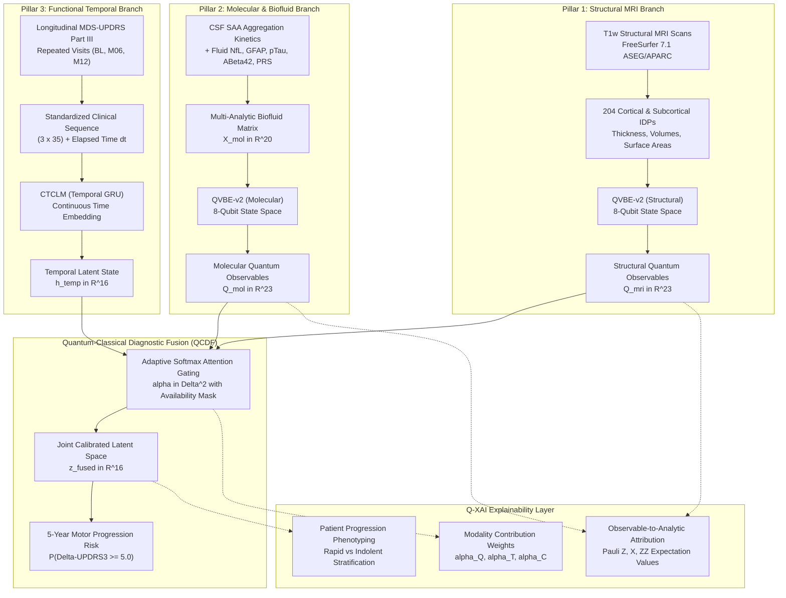

# NĀḌĪ-Q — Final Integrated System Architecture
## Hybrid Quantum-Classical Multi-Modal Platform for Early Disease Detection & Progression Prognosis

**Project**: NĀḌĪ-Q (Smart India Hackathon 2026, Submission SIH26139)  
**System Specification Document**: Authoritative Architecture Specification  
**Authors**: Lead Quantum ML Researcher, Biomedical AI Researcher & Senior Systems Architect  
**Date**: November 14, 2026  
**Status**: ARCHITECTURAL SPECIFICATION APPROVED  

---

## 1. Architectural Philosophy & The Three-Pillar Design

NĀḌĪ-Q is designed to address a critical limitation in current neurological disease diagnostics: neurodegenerative diseases such as Parkinson's disease (PD) and related synucleinopathies develop silent molecular and cellular pathology up to 10–20 years before the clinical manifestation of classic motor symptoms (tremor, rigidity, bradykinesia, postural instability). 

Traditional predictive models either focus on a single modality (e.g. neuroimaging alone or clinical rating scales alone) or employ crude concatenation of cross-sectional static features. As demonstrated in our Phase 1–6 forensic audits, static cross-sectional morphometry alone achieves random chance ($0.4818$ AUROC) for predicting 5-year functional motor decline, while naive concatenation causes dimensional dilution and overfitting.

NĀḌĪ-Q resolves this through an **asymmetric three-pillar architecture** that maps heterogeneous biological scales into coordinated latent spaces:

---

## 2. Pillar 1: Structural MRI Branch

### 2.1 Inputs and Morphometric Processing
* **Acquisition Standard**: 3D T1-weighted magnetization-prepared rapid gradient-echo (MPRAGE) sequence ($1.0 \times 1.0 \times 1.0\text{ mm}^3$ isotropic resolution).
* **Parcellation & Segmentation**: Processed via the validated FreeSurfer 7.1 longitudinal stream.
* **Feature Representation ($X_{\text{mri}} \in \mathbb{R}^{204}$)**:
  - Cortical thickness measures (`cth_*`): 68 regional Desikan-Killiany parcels (34 per hemisphere).
  - Subcortical volumetric structures (`aseg_*`): 40 subcortical segmentations (including bilateral caudate, putamen, globus pallidus, substantia nigra, thalamus, hippocampus, and ventricles).
  - Surface area metrics (`sa_*`): 68 regional cortical surface areas.
  - White matter hypointensity volumes (`wm_*`): 28 regional white matter tracts.

### 2.2 Structural Quantum Variational Biomarker Embedding ($\text{QVBE}_{\text{mri}}$)
The 204 FreeSurfer morphometric features are normalized via training-fitted StandardScalers and mapped to the 8-qubit variational circuit:
$$\mathbf{\theta}_{\text{mri}} = \pi \cdot \sigma(W_{\text{mri}} X_{\text{mri}} + b_{\text{mri}}) \in [0, \pi]^8$$
The circuit executes parameterized cyclic $U_3$ rotations and cyclic entanglement, measuring multi-basis Pauli expectation values:
$$Q_{\text{mri}} = \left[ \langle Z_i \rangle_{i=1}^8, \langle X_i \rangle_{i=1}^8, \langle Z_i Z_{i+1} \rangle_{i=1}^7 \right] \in \mathbb{R}^{23}$$

---

## 3. Pillar 2: Molecular Biofluid & Genetic Branch

### 3.1 Biological Analytes & Kinetics ($X_{\text{mol}} \in \mathbb{R}^{20}$)
The molecular branch integrates fluid-based markers across three complementary biological domains:
1. **Synucleinopathy (Seed Amplification Assay)**:
   - Qualitative SAA positivity in cerebrospinal fluid (binary status).
   - Quantitative seeding aggregation kinetics: maximum fluorescence intensity ($F_{\text{max}}$), maximum elongation slope ($\text{Slope}_{\text{max}}$), area under the kinetic amplification curve (AUC), and threshold latency time (TTT).
2. **Neuroaxonal Injury & Neuroinflammation**:
   - Quantitative Neurofilament Light Chain (NfL) in CSF and Plasma (measured via ultra-sensitive Quanterix Simoa assays).
   - Glial Fibrillary Acidic Protein (GFAP) in CSF and Plasma (astrocytic activation and neuroinflammation).
3. **Co-Pathology (Tau & Amyloid)**:
   - Phosphorylated tau-181 ($\text{pTau}_{181}$) and Total Tau ($\text{tTau}$) in CSF.
   - Amyloid-beta 1-42 ($\text{A}\beta_{42}$) in CSF.
4. **Genetics & Polygenic Risk**:
   - Pathogenic variant indicators: *LRRK2* (G2019S), *GBA* (N370S/L444P), *APOE* $\epsilon 4$ carrier status.
   - Genome-wide Polygenic Risk Scores: GP2 PGS, META5 overall PD risk score, and META5 excluding LRRK2/GBA.

### 3.2 Molecular Quantum Variational Biomarker Embedding ($\text{QVBE}_{\text{mol}}$)
$X_{\text{mol}}$ is scaled using training-fitted RobustScalers (accounting for skewed biofluid distributions) and encoded into the 8-qubit register:
$$Q_{\text{mol}} = \left[ \langle Z_i \rangle_{i=1}^8, \langle X_i \rangle_{i=1}^8, \langle Z_i Z_{i+1} \rangle_{i=1}^7 \right] \in \mathbb{R}^{23}$$
This extracts non-linear entanglement correlations between proteinopathy kinetics, neuroaxonal damage, and genetic susceptibility.

---

## 4. Pillar 3: Classical Temporal-Clinical Learning Module (CTCLM)

### 4.1 Temporal Clinical Sequence ($X_{\text{temp}} \in \mathbb{R}^{3 \times 35}$)
The functional motor branch tracks repeated clinical examinations at baseline ($t_0 = 0.0\text{ yr}$), Visit 02 ($t_1 \approx 0.5\text{ yr}$), and Visit 04 ($t_2 \approx 1.0\text{ yr}$). At each visit, 35 standardized clinical parameters are recorded:
- MDS-UPDRS Part III total motor score (`NP3TOT`).
- 4 anatomical subscores: Tremor, Rigidity, Bradykinesia, Axial/Gait.
- 30 individual motor examination items (speech, facial expression, finger tapping, hand movements, pronation/supination, leg agility, rising from chair, gait, freezing, postural stability, posture, resting tremor).

### 4.2 Continuous Time-Aware Recurrent Formulation
Because clinical visit schedules exhibit irregular elapsed intervals ($\Delta t$), CTCLM projects elapsed time into a continuous 4-dimensional temporal embedding:
$$\mathbf{\tau}(t) = \text{LayerNorm}\left( \text{GELU}\left( W_t [t, \sin(2\pi t), \cos(2\pi t), \Delta t]^T + b_t \right) \right) \in \mathbb{R}^4$$
At each visit step $k \in \{0, 1, 2\}$, the input vector is the concatenation of clinical examination items and the time embedding:
$$\mathbf{u}_k = [\mathbf{x}_k \,\|\, \mathbf{\tau}(t_k)] \in \mathbb{R}^{39}$$
The sequence is processed via a continuous Gated Recurrent Unit (GRU):
$$\mathbf{h}_k = \text{GRU}(\mathbf{u}_k, \mathbf{h}_{k-1}), \quad \mathbf{h}_0 = \mathbf{0}$$
The final hidden state $\mathbf{h}_{\text{temp}} = \mathbf{h}_2 \in \mathbb{R}^{16}$ encapsulates early motor velocity, acceleration, and subscore asymmetry.

---

## 5. Quantum-Classical Diagnostic Fusion (QCDF)

### 5.1 Modality Projection Heads
Each modality representation is projected into a shared 16-dimensional embedding space:
$$\mathbf{z}_Q = \text{ReLU}\left( \text{LayerNorm}(W_Q Q_{\text{mol}} + b_Q) \right) \in \mathbb{R}^{16}$$
$$\mathbf{z}_T = \text{ReLU}\left( \text{LayerNorm}(W_T \mathbf{h}_{\text{temp}} + b_T) \right) \in \mathbb{R}^{16}$$
$$\mathbf{z}_C = \text{ReLU}\left( \text{LayerNorm}(W_C Q_{\text{mri}} + b_C) \right) \in \mathbb{R}^{16}$$

### 5.2 Dynamic Softmax Attention Gating with Availability Masking
To prevent uninformative or missing modalities from corrupting downstream predictions, QCDF computes dynamic gating coefficients conditioned on the patient's joint representation:
$$\mathbf{g} = W_g [\mathbf{z}_Q \,\|\, \mathbf{z}_T \,\|\, \mathbf{z}_C] + \mathbf{b}_g \in \mathbb{R}^3$$
If a modality $m \in \{Q, T, C\}$ is missing for a given patient, an availability mask $\mathbf{a} \in \{0, 1\}^3$ applies an additive penalty:
$$\tilde{g}_m = g_m + (1 - a_m) \cdot (-10^4)$$
The normalized attention weights are obtained via softmax:
$$\mathbf{\alpha} = [\alpha_Q, \alpha_T, \alpha_C]^T = \text{Softmax}(\mathbf{\tilde{g}}) \in \Delta^2$$
The fused patient representation is the convex combination:
$$\mathbf{z}_{\text{fused}} = \alpha_Q \mathbf{z}_Q + \alpha_T \mathbf{z}_T + \alpha_C \mathbf{z}_C \in \mathbb{R}^{16}$$
The progression probability is computed via a calibrated sigmoid classification head:
$$\hat{y} = \sigma\left( W_{\text{out}} \mathbf{z}_{\text{fused}} + b_{\text{out}} \right) = P\left( \Delta \text{NP3TOT}_{5\text{yr}} \ge 5.0 \mid X \right)$$

---

## 6. Quantum Explainability Layer (Q-XAI)

The Q-XAI module provides transparent, clinically interpretable risk attributions at three distinct levels:
1. **Dynamic Modality Attribution**: Evaluates the patient-specific gating weights $(\alpha_Q, \alpha_T, \alpha_C)$, explaining whether the prognosis is driven primarily by temporal functional decline ($\alpha_T$), molecular proteinopathy/neuroaxonal damage ($\alpha_Q$), or structural brain atrophy ($\alpha_C$).
2. **Observable-to-Analytic Decomposition**: Computes the Jacobian sensitivity of quantum observables with respect to input biological assays:
   $$J_{i, j} = \frac{\partial \langle \hat{O}_i \rangle}{\partial x_j}$$
   linking high-risk quantum states directly back to elevated Plasma NfL, CSF pTau181, or basal ganglia volume loss.
3. **Patient Progression Subgroup Profiling**: Maps the patient into empirical progression archetypes discovered through unsupervised manifold clustering.

