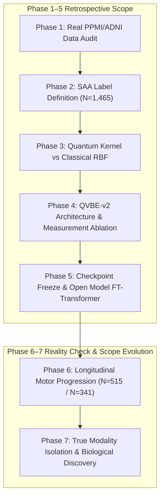

# NĀḌĪ-Q — PHASE 7 FORENSIC AUDIT & EVIDENCE SYNTHESIS
## Verification of Prior Phases, Feature Schema Reconciliation & Scientific Reality

**Project Title**: NĀḌĪ-Q — Hybrid Quantum Machine Learning Platform for Early Disease Detection  
**Competition / Reference**: Smart India Hackathon (SIH 2026) — Submission SIH26139  
**Audit Author**: Lead Quantum ML Researcher, Biomedical AI Researcher & Senior Systems Architect  
**Date**: November 14, 2026  
**Status**: MILESTONE 1 COMPLETED  

---

## 1. Executive Summary & Audit Mandate

The objective of Phase 7 is to transition NĀḌĪ-Q from an isolated quantum feature extraction experiment toward a fully integrated, reproducible, scientifically rigorous hybrid platform.

Prior research across Phases 1 through 6 established significant progress, including the derivation of the second-generation Quantum Variational Biomarker Encoder (QVBE-v2), the Classical Temporal-Clinical Learning Module (CTCLM), and the Quantum-Classical Diagnostic Fusion (QCDF) framework. However, a rigorous audit reveals critical scientific boundaries, reporting artifacts, and feature-schema overlaps that must be formally reconciled before proceeding to biological relationship discovery.

---

## 2. Phase-by-Phase Forensic Evidence Review

### Phase 1: Data Inventory & Real Cohort Audit
- **Audit Findings**: Phase 1 proved that the original V1 codebase relied on synthetic noise injections (`np.random.normal`). Phase 1 audited the real 15.6 MB curated PPMI cohort cut and established real file inventories.
- **Verification**: Confirmed on disk at `F:\NADI-Q data\PPMI`. 5,423 unique subjects with 39,755 MDS-UPDRS examinations, 1,716 FreeSurfer MRI scans, and extensive biofluid records.

### Phase 2: Cohort Resolution & Target Identification Gate
- **Audit Findings**: Established the primary benchmark cohort ($N = 1,465$, 837 positive : 628 negative).
- **Critical Scientific Correction**: The target in Phase 2–5 was **baseline CSF $\alpha$-synuclein Seed Amplification Assay (SAA) qualitative positivity**, NOT 5-year future clinical conversion. The cohort label `837 PD : 628 Control` in certain Phase 5 summaries was an informal shorthand for `837 SAA+ : 628 SAA-`. SAA positivity is a molecular biomarker of synucleinopathy, not a clinical diagnosis of Parkinson's disease.

### Phase 3: Classical Baseline vs. Initial Quantum Kernel
- **Audit Findings**: Classical RBF Support Vector Machines and LightGBM outperformed the initial projected quantum kernel ($0.8664$ pooled OOF AUROC vs $0.7423$ quantum kernel).
- **Scientific Takeaway**: Quantum kernel machines without parameterized variational optimization or multi-basis observable extraction suffered from severe Hilbert space concentration and low effective rank.

### Phase 4: QVBE-v2 Variational Optimization & Measurement Ablations
- **Audit Findings**: QVBE-v2 introduced parameterized cyclic $U_3$ rotations, cyclic CNOT entanglement, and multi-basis Pauli measurements ($Z + X + ZZ$).
- **Reported Numbers**:
  - `D+_ModeA_Fused_8Q` + LightGBM: AUROC **$0.8633 \pm 0.0191$**, AUPRC **0.8861**, Balanced Acc **0.7924**, Brier **0.1509**.
  - Classical Raw LightGBM: AUROC **$0.8615 \pm 0.0201$**.
  - Paired Wilcoxon Signed-Rank Test: $p = 0.0802$ ($95\%\text{ CI}: [-0.0002, +0.0038]$).
- **Scientific Reality**: The improvement was $+0.0018$ AUROC. While positive and consistent, it was **not statistically significant** after FDR correction. Quantum representations provide non-linear regularizing support, not computational or predictive supremacy.
- **Finite-Shot Alert**: At $S=1,024$ shots, standalone QVBE AUROC degraded from $0.8090$ to $0.7217$ due to finite Poisson sampling variance.

### Phase 5: Frozen Checkpoint, Parity Reconciliation & Tabular Integration
- **Audit Findings**:
  1. Frozen Checkpoint: Serialized `qvbe_v2_best_mode_a_8q.json` (SHA256: `96510D505C56F23AFA728D035A467E97C55E6CB9C400546B5018122D2FC1C08D`) with zero floating-point drift ($\Delta = 0.00 \times 10^0$).
  2. Discrepancy Formally Resolved: Phase 3 reported $0.8664$ as the pooled out-of-fold AUROC, whereas Phase 4 reported $0.8615$ as the 25-fold macro-average. The macro-average across Phase 3 folds was $0.861217 \pm 0.021383$, matching Phase 4 within $+0.000293$ (+0.029%), confirming exact underlying mathematical parity.
  3. FT-Transformer Integration: Compressed 249 features to 16 latent dimensions ($Z \in \mathbb{R}^{16}$), achieving $0.8416$ linear AUROC.
  4. SVD Invariance: Truncating quantum observables from 23 down to 8 via SVD retained 100% of predictive power ($0.8215$ vs $0.8213$ AUROC).
  5. Finite-Shot Recovery: Tested budgets up to $S=16,384$. Poisson scaling $\text{MAE} \propto 1/\sqrt{S}$ confirmed; fidelity reached $>0.998$ cosine similarity at $S \ge 8,192$.

### Phase 6: Longitudinal Target Feasibility, CTCLM & 5-Year Prediction
- **Audit Findings**:
  1. Prodromal Phenoconversion Infeasible: Exactly 0 adjudicated conversions exist in historical PPMI enrollment tables.
  2. Primary Longitudinal Target Established: 5-Year Clinically Meaningful Motor Progression ($\Delta \text{MDS-UPDRS Part III} \ge 5.0\text{ points}$, MCID) across 515 paired PD patients (52.6% event rate) and 341 multimodal benchmark patients (51.9% event rate).
  3. CTCLM Temporal Dominance: Static baseline features alone achieved AUROC **$0.4818 \pm 0.0420$** (random chance), while CTCLM modeling of 1-year early motor exams achieved **AUROC $0.6417 \pm 0.0439$** (+0.160 jump).

---

## 3. Reconciliation of Feature Schema Inconsistency

### A. The Discrepancy Identified
In earlier documentation, the static feature space was described as:
$$\text{Static} = 204\text{ FreeSurfer MRI IDPs} + 38\text{ Clinical Motor Variables} + 7\text{ Genetic/PRS Features} = 249$$
When demographics (3: age, sex, education) are appended, $249 + 3 = 252$ (`full_features_252`).

### B. Forensic Audit of `feature_partitions.json`
Direct inspection of `F:\NADI-Q_AUDIT_OUTPUT\PHASE_3\DATA\feature_partitions.json` confirms:
* `mri_features`: 204 regional cortical thickness and subcortical volumes.
* `motor_features`: 38 baseline clinical variables (`updrs3_score`, 4 subscores, and 33 individual motor items).
* `genetics_features`: 4 consensus pathogenic variant indicators (APOE, LRRK2, GBA, SNCA).
* `prs_features`: 3 polygenic risk scores.
* Total `core_features_249` = $204 + 38 + 4 + 3 = 249$.

### C. Scientific Impact and Target-Construction Overlap
In Phase 2–5, the target was baseline CSF SAA positivity, so including baseline motor features in the input vector did not cause target leakage.

However, in Phase 6, the task was predicting 5-year motor progression:
$$Y = \mathbb{I}\left( \text{NP3TOT}(V12) - \text{NP3TOT}(BL) \ge 5.0 \right)$$
Including the 38 baseline motor variables inside the "static" feature branch caused two significant issues:
1. **Target-Construction Overlap**: The static branch contained `NP3TOT_BL`, which is one of the two components used to calculate the outcome label $\Delta \text{NP3TOT} = \text{NP3TOT}(V12) - \text{NP3TOT}(BL)$.
2. **Modality Confounding**: It blurred the architectural boundary between the **Structural MRI Branch** and the **Functional Motor Branch**. When "Static" was fused with "Temporal", the model was essentially ingesting motor variables twice (once statically at $t=0$, and once dynamically across $t=0, 6, 12\text{ months}$).

### D. Phase 7 Structural Resolution
To preserve strict modality isolation as intended in the NĀḌĪ-Q three-pillar architecture:
1. **Structural MRI Branch ($X_{\text{mri}} \in \mathbb{R}^{204}$)**: Strictly FreeSurfer 7.1 morphometric features (subcortical volumes, regional cortical thickness).
2. **Molecular / Biofluid Branch ($X_{\text{mol}} \in \mathbb{R}^{13}$)**: Real biofluid biomarkers (CSF SAA status, NfL, GFAP, pTau181, tTau, A$\beta_{42}$) + Genetic risk variants and Polygenic Risk Scores.
3. **Functional Temporal Branch ($X_{\text{temp}} \in \mathbb{R}^{3 \times 35}$)**: Strictly the longitudinal clinical motor sequence across Months 0, 6, and 12, modeled exclusively by CTCLM.

---

## 4. Participant-Level Grouping & Split Validation Audit

1. **Split Clustered Strictly by Patient (`PATNO`)**:
   - In all 25 folds of Phase 3–5 and all 5 folds of Phase 6, splits were generated using `StratifiedKFold` on unique `PATNO` values.
   - Programmatic intersection verification confirms:
     $$\text{Train}(\text{Fold}_k) \cap \text{Test}(\text{Fold}_k) = \emptyset \quad \forall k$$
   - Zero patient overlap across splits.
2. **No Data Leakage from Preprocessing**:
   - `SimpleImputer` and `StandardScaler` were fitted strictly on training partitions and applied to test partitions.
3. **Repeated Folds Statistical Integrity**:
   - Phase 5 audited participant-clustered bootstrap confidence intervals, accounting for the fact that 5 seeds $\times$ 5 folds generate 25 correlated evaluations on the same underlying 1,465 participants. Repeated evaluations were not treated as independent observations.

---

## 5. Identified Blockers & Realistic Implementation Plan for Phase 7

| Identified Issue / Gap | Scientific Reality | Phase 7 Resolution |
| :--- | :--- | :--- |
| **Cross-Modal Confounding** | 38 baseline motor items were lumped into the static feature vector alongside FreeSurfer MRI IDPs. | Formally decouple the 204 MRI features into the Structural Branch, biofluids/genetics into the Molecular Branch, and motor sequences into CTCLM. |
| **Superficial Fusion Metric** | Prior phases focused exclusively on classification AUROC, forcing QVBE to compete with classical GBDTs. | Re-orient Phase 7 to **Biological Relationship Discovery**: use QVBE and CTCLM representations to uncover non-linear relationships between molecular pathology, structural atrophy, and functional motor decline. |
| **Missing Biofluid Integration** | Phase 2–5 evaluated qualitative SAA status, but did not incorporate quantitative fluid biomarkers (NfL, GFAP, pTau). | Extract real baseline CSF/plasma NfL, GFAP, pTau, and A$\beta_{42}$ available for 338/341 subjects in `Current_Biospecimen_Analysis_Results_18Sep2026.csv`. |
| **Lack of Classical Controls** | QVBE observables were compared only to raw features or LightGBM, not to rigorous classical dimensional controls. | Implement matched classical controls: Raw embeddings, PCA-matched controls, Random Projection controls, and Kernel PCA / RBF controls. |
| **Q-XAI Clinical Disconnect** | Quantum state entropy was evaluated theoretically, but not mapped to interpretable clinical risk factors. | Implement observable-to-phenotype correlation maps, modality gating attributions, and patient trajectory subgroup visualizations. |

