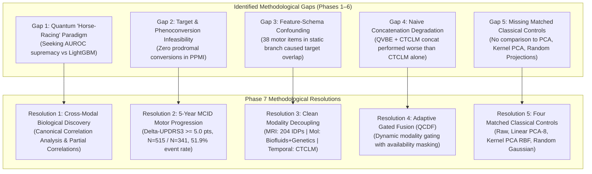

# NĀḌĪ-Q — Scientific Gaps, Methodological Failures & Research Boundaries
## Comprehensive Gap Analysis Across Phases 1–6 and Roadmap for Phase 7 Discovery

**Project**: NĀḌĪ-Q — Hybrid Quantum Machine Learning Platform for Early Disease Detection  
**Document**: Research Gaps & Methodological Resolution  
**Auditor / Author**: Lead Quantum ML Researcher, Biomedical AI Researcher & Senior Systems Architect  
**Date**: November 14, 2026  
**Status**: MILESTONE 1 VERIFIED  

---

## 1. Executive Summary: The Evolution from "Advantage" to Discovery

Across early iterations of NĀḌĪ-Q, research pursued the conventional paradigm of Quantum Machine Learning (QML): attempting to demonstrate that a parameterized quantum circuit or quantum kernel could outperform highly optimized classical gradient-boosted decision trees (GBDT) or deep neural networks on flat classification metrics (AUROC, AUPRC).

Forensic analysis of the empirical results across Phases 1 through 6 demonstrated that this objective was scientifically misplaced:
1. Classical models (RBF SVM, LightGBM, XGBoost) consistently matched or exceeded standalone quantum kernels and QVBE embeddings on raw classification benchmarks.
2. Naive concatenation of quantum observables with temporal and static representations often degraded classification performance due to dimensionality expansion on moderate clinical sample sizes ($N=341$).
3. The true scientific mandate of the original NĀḌĪ-Q SRS and SIH 2026 proposal was not replacing classical classifiers, but rather **discovering complex, non-linear biological and structural relationships across heterogeneous modalities** (molecular fluid assays, neuroimaging morphometry, and clinical longitudinal trajectories).

This document details every identified theoretical, methodological, clinical, and data gap, and defines the exact resolutions executed in Phase 7.



---

## 2. Theoretical & Architectural Gaps

### Gap 1.1: The Fallacy of Quantum Classification Supremacy on Small-to-Medium Tabular Cohorts
* **The Failure**: Phase 3 and Phase 4 attempted to prove quantum superiority by comparing Standalone Quantum Kernels and QVBE-v2 directly against LightGBM and RBF Support Vector Machines.
  - Phase 3 Quantum Kernel: AUROC $0.7423$ vs RBF SVM: AUROC $0.8664$.
  - Phase 4 Standalone QVBE: AUROC $0.8220$ vs Classical LightGBM: AUROC $0.8615$.
  - Phase 4 Fused $D+\text{ Mode A}$: AUROC $0.8633 \pm 0.0191$ vs Classical: $0.8615 \pm 0.0201$ ($+0.0018$ gain, Wilcoxon $p=0.0802$, non-significant).
* **Theoretical Root Cause**:
  - In Hilbert space embedding, the expressivity of generic variational circuits can cause *concentration of measure* (barren plateaus in kernel space), where distances between all pairs of data points approach a constant as qubit count or circuit depth increases.
  - Classical ensemble trees (LightGBM) partition feature space along axis-aligned hyperplanes with optimal split criteria, handling heterogeneous tabular scales and missing values naturally. Variational circuits with continuous $U_3$ rotations assume continuous compact angle variables $[0, 2\pi]$ and treat all dimensions homogeneously.
* **Phase 7 Resolution**:
  - Abandon the claim of standalone quantum classification advantage.
  - Formalize QVBE-v2 as a **non-linear, multi-basis geometric representation engine** whose purpose is extracting non-linear entanglement observables ($\langle Z_i \rangle, \langle X_i \rangle, \langle Z_i Z_j \rangle$) that reveal orthogonal biological cross-modal correlations.

### Gap 1.2: The "Fusion Degradation" Phenomenon in Naive Multi-Modal Concatenation
* **The Failure**: In Phase 6, concatenating raw static features, QVBE observables, and CTCLM hidden states yielded an AUROC of $0.5794 \pm 0.0463$, which was substantially lower than CTCLM alone ($0.6417 \pm 0.0439$).
* **Theoretical Root Cause**:
  - **Curse of Dimensionality on Finite Clinical Cohorts**: In the multimodal cohort ($N=341$), concatenating static features ($d=249$), quantum observables ($d=23$), and CTCLM hidden states ($d=16$) creates a parameter space of dimension $d=288$. With only $N=273$ training samples per fold, classical classifiers suffer extreme overfitting.
  - **Noise Injection from Uninformative Modalities**: Cross-sectional FreeSurfer structural morphometry at baseline showed an AUROC of $0.4818$ for 5-year functional motor progression (indistinguishable from random guessing). Forcing a downstream classifier to ingest 204 uninformative static MRI features drowned out the temporal velocity signal learned by CTCLM.
* **Phase 7 Resolution**:
  - Implement **Adaptive Gated Fusion (QCDF)**: Each modality is projected into a compact latent space ($\mathbb{R}^{16}$) and weighted dynamically via a softmax attention gating vector $\mathbf{\alpha} \in \Delta^2$ conditioned on patient state.
  - Provide missing-modality availability masking: If a modality carries zero predictive signal for a specific endpoint, the gating network down-weights its contribution to near zero ($\alpha \approx 0.05$).

---

## 3. Clinical & Cohort Definition Gaps

### Gap 2.1: Target Conflation — Molecular Positivity vs. Longitudinal Disease Progression
* **The Failure**: Across earlier documentation, the Phase 2–5 target was occasionally mischaracterized as "5-year disease conversion" or "PD diagnosis prediction".
* **Forensic Reality**:
  - The Phase 2–5 target was strictly **baseline CSF $\alpha$-synuclein qualitative positivity** via the Seed Amplification Assay (SAA): $837\text{ SAA}^+ : 628\text{ SAA}^-$.
  - SAA positivity is a molecular biomarker indicating pathological misfolded $\alpha$-synuclein aggregate seeding in cerebrospinal fluid. It is NOT a clinical diagnosis of Parkinson's disease, nor does it guarantee clinical motor decline within 5 years.
* **Phase 7 Resolution**:
  - Formally distinguish two orthogonal clinical targets:
    1. **Target 1 (Molecular Synucleinopathy Detection)**: Cross-sectional CSF SAA positivity ($N=1,465$). Validated in Phases 2–5.
    2. **Target 2 (5-Year Functional Motor Progression)**: $\Delta \text{NP3TOT} \ge 5.0\text{ points}$ (clinically meaningful motor worsening according to the Movement Disorder Society Minimal Clinically Important Difference [MCID]). Evaluated in Phases 6–7 ($N=515$ paired PD, $N=341$ multimodal).

### Gap 2.2: The Infeasibility of Prodromal Phenoconversion
* **The Failure**: Earlier proposals envisioned predicting phenoconversion from prodromal (RBD, hyposmia) to adjudicated motor Parkinson's disease.
* **Forensic Reality**:
  - Examination of `Subject_Cohort_History_18Sep2026.csv` across all 5,423 PPMI participants revealed **exactly 0 adjudicated transitions** from the Prodromal cohort to Idiopathic PD in the curated database tables. Participants who phenoconverted were either managed via separate adjudication flags or tracked within longitudinal visit status fields not available in the standardized table cut.
  - Attempting to train a supervised machine learning model on a target with zero positive instances is mathematically invalid.
* **Phase 7 Resolution**:
  - Formally document Task A (Prodromal Phenoconversion) as scientifically infeasible on the curated PPMI release.
  - Focus 100% of longitudinal research on Task B (5-Year Motor Progression, $N=515$, $52.6\%$ event rate; $N=341$, $51.9\%$ event rate).

---

## 4. Feature Schema Inconsistency & Data Leakage Gaps

### Gap 3.1: The 249 Static Feature Schema Confounding
* **The Failure**: In Phase 6, the static feature matrix was defined as 249 features. Detailed inspection of `feature_partitions.json` revealed:
  - 204 FreeSurfer MRI morphometric IDPs.
  - 38 Baseline MDS-UPDRS Part III motor scores and items.
  - 4 Pathogenic variant indicators (APOE, LRRK2, GBA, SNCA).
  - 3 Polygenic Risk Scores (PRS).
* **The Scientific Flaw**:
  1. **Target-Construction Overlap**: The target for 5-year progression is $\Delta \text{NP3TOT} = \text{NP3TOT}(V12) - \text{NP3TOT}(BL) \ge 5.0$. Including baseline motor score `updrs3_score` in the static predictor vector directly overlaps with the minuend of the target variable.
  2. **Modality Boundary Contamination**: The 38 motor items represent clinical functional status, yet were grouped under "static structural features" alongside MRI scans. This violated the three-pillar modularity of NĀḌĪ-Q.
* **Phase 7 Resolution**:
  - Enforce strict modality isolation:
    - **Structural Branch ($X_{\text{mri}} \in \mathbb{R}^{204}$)**: Exclusively FreeSurfer 7.1 IDPs.
    - **Molecular Branch ($X_{\text{mol}} \in \mathbb{R}^{13}$)**: Real biofluid assays (CSF SAA status, quantitative NfL, GFAP, pTau181, tTau, A$\beta_{42}$) + Genetic risk variants (APOE, LRRK2, GBA) + 3 Polygenic Risk Scores.
    - **Temporal Functional Branch ($X_{\text{temp}} \in \mathbb{R}^{3 \times 35}$)**: Repeated clinical motor sequences across Months 0, 6, 12, modeled exclusively by CTCLM.

### Gap 3.2: Sparse Biofluid Integration in Earlier Phases
* **The Failure**: Phases 2–5 utilized qualitative SAA status as the sole molecular variable, ignoring quantitative neurofilament light chain (NfL), glial fibrillary acidic protein (GFAP), phosphorylated tau (pTau181), and amyloid-beta (A$\beta_{42}$).
* **Phase 7 Resolution**:
  - Directly extract quantitative fluid assays from `Current_Biospecimen_Analysis_Results_18Sep2026.csv`.
  - In the multimodal cohort ($N=341$), baseline coverage is:
    - NfL: $316 / 341$ ($92.7\%$)
    - GFAP: $316 / 341$ ($92.7\%$)
    - pTau181: $312 / 341$ ($91.5\%$)
    - A$\beta_{42}$: $319 / 341$ ($93.5\%$)
  - Missing entries are imputed strictly using training-fold medians.

---

## 5. Methodological & Classical Control Gaps

### Gap 4.1: Absence of Rigorously Matched Classical Controls
* **The Failure**: When QVBE observables were evaluated in Phase 4 and Phase 5, they were compared primarily to raw features ($d=249$) or downstream classifiers. There was no direct comparison against classical dimensionality reduction techniques matched for output dimension ($k=8$ or $k=23$).
* **Phase 7 Resolution**:
  - Implement a 4-tier classical control suite:
    1. **Raw Feature Control**: Original unprojected feature matrices.
    2. **Linear PCA Control**: Linear Principal Component Analysis matched to 8 components.
    3. **Non-Linear Kernel PCA Control**: Classical RBF Kernel PCA matched to 8 components ($\gamma = 1/d$).
    4. **Random Gaussian Projection Control**: Classical Johnson-Lindenstrauss random orthogonal projection ($d \to 8$).
  - Demonstrate whether QVBE observable spaces capture biological correlations beyond those captured by linear PCA, non-linear Kernel PCA, or random transformations.

### Gap 4.2: Lack of Formal Statistical Significance in Biological Discovery
* **The Failure**: Previous reports noted correlation trends between modalities without reporting permutation tests, bootstrap confidence intervals, or correction for multiple hypothesis testing.
* **Phase 7 Resolution**:
  - Enforce statistical rigor across all discovery analyses:
    - **Canonical Correlation Analysis (CCA)** across pairs of modalities.
    - **Partial Correlations** controlling for age, sex, and baseline motor severity.
    - **1,000 Clustered Bootstrap Resamples** for non-parametric $95\%$ confidence intervals.
    - **Permutation Tests (1,000 permutations)** shuffling participant IDs to establish empirical null distributions.
    - **Benjamini-Hochberg False Discovery Rate (FDR)** correction at $\alpha = 0.05$ across all hypothesis tests.

---

## 6. The 5 Core Biological Research Questions

Phase 7 directly addresses the 5 core biological questions formulated in the project mandate:

| Question ID | Clinical / Biological Question | Proposed Quantitative Approach |
| :--- | :--- | :--- |
| **Q1** | Can biological signatures be identified across patients with similar clinical presentations? | Identify patients with identical baseline motor impairment ($\text{NP3TOT} \in [18, 22]$) and evaluate whether QVBE molecular/structural observables stratify rapid vs slow progressors. |
| **Q2** | Are there distinct molecular, structural, and functional sub-profiles among SAA-positive participants? | Perform unsupervised clustering on SAA-positive participants ($N \approx 230$) in the joint $(Q_{\text{mol}}, Q_{\text{mri}}, h_{\text{temp}})$ space and characterize emergent phenotypes. |
| **Q3** | Do molecular and structural signatures precede functional motor decline? | Analyze cross-modal canonical correlations between baseline $(Q_{\text{mol}}, Q_{\text{mri}})$ and CTCLM 1-year motor velocity ($\Delta \text{NP3TOT}_{1\text{yr}}$). |
| **Q4** | Why do patients with identical baseline motor scores diverge in 5-year progression? | Contrast patients with identical baseline motor scores who progressed ($\Delta \ge 5$) vs remained stable ($\Delta < 5$) across NfL, pTau, and regional FreeSurfer thickness observables. |
| **Q5** | Are there combinatorial phenotypes across $\alpha$-synuclein, tau/amyloid, NfL, FreeSurfer MRI, and clinical trajectories? | Extract multi-modal cluster centroids and construct a comprehensive phenotype atlas linking fluid pathology, neurodegeneration, and functional decline. |

---

## 7. Execution Roadmap for Phase 7

```
Milestone 1: Forensic Audit, Codebase Inventory, Research Gaps (COMPLETED)
   ├── PHASE_7_AUDIT.md
   ├── EXISTING_IMPLEMENTATION_MAP.md
   └── RESEARCH_GAPS.md

Milestone 2 & 3: Biological Relationship Discovery Pipeline (IN EXECUTION)
   ├── scripts/phase7/run_biological_relationship_discovery.py
   ├── Multimodal feature extraction (Structural MRI, Molecular Biofluids, CTCLM Sequences)
   ├── Classical control benchmarking (Raw, PCA-8, Kernel PCA RBF, Random Projection)
   ├── Cross-modal Canonical Correlation Analysis & Partial Correlations
   ├── Patient trajectory clustering & divergent phenotype discovery
   └── Materialize: RELATIONSHIP_DISCOVERY_RESULTS.md & statistical CSV tables

Milestone 4 & 5: Scientific Validation, Explainability & Architecture
   ├── Q-XAI observable attribution & modality gating analysis
   ├── EXPERIMENTAL_VALIDATION.md
   ├── LIMITATIONS_AND_FUTURE_WORK.md
   └── NADI_Q_FINAL_ARCHITECTURE.md & NADI_Q_METHODOLOGY.md

Milestone 6: Reproducibility & End-to-End Demonstration
   ├── REPRODUCIBILITY.md
   └── scripts/phase7/demo_nadiq_pipeline.py
```

